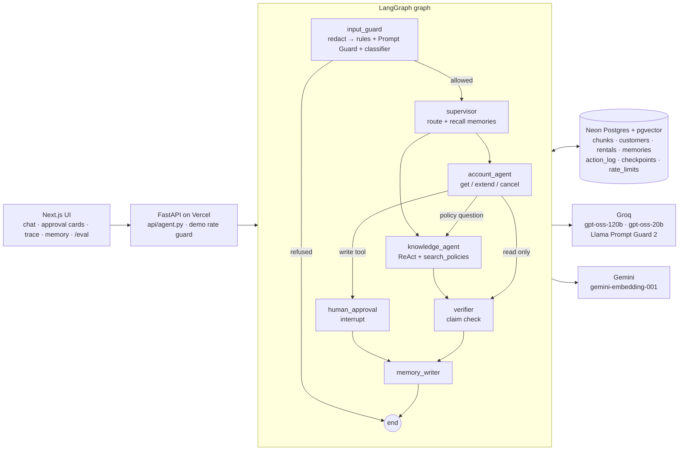

# Tandem Desk

A guarded multi-agent support assistant for **Velomarsh**, a fictional bike-rental service.
LangGraph agents answer policy questions with agentic RAG and act on a customer's rentals
through function calls, behind PII redaction, topic and action guardrails, human approval of
every action, long-term customer memory and a fact-check filter that blocks unsupported
answers. An async evaluation harness measures the hallucination rate with the fact check on
and off.

All data is synthetic: about 20 policy documents, 3 customers with rentals, and fake personal
data (example.com addresses, 555 phone numbers, card test numbers, generated IBANs).

Live demo: https://tandem-desk-nine.vercel.app (evaluation results at
[/eval](https://tandem-desk-nine.vercel.app/eval)).

## What it does

Pick a customer, then ask about a policy ("What is the late fee for an e-bike?") or about a
rental ("Please extend R-2001 by 2 days"):

1. Personal data in the message is replaced with typed placeholders before any model sees it.
2. An input guard refuses off-topic and prompt-injection messages before any agent runs.
3. A supervisor routes the turn to the **knowledge agent** (policy questions) or the
   **account agent** (the customer's rentals) and recalls the customer's memories. The account
   agent hands general policy questions over to the knowledge agent.
4. The knowledge agent searches the policies in a ReAct loop and drafts a cited answer; the
   account agent calls typed tools. A change to a rental pauses the graph and shows an
   Approve/Reject card; the change runs only with a server-signed approval token.
5. A verifier checks each claim of the draft against the evidence retrieved in that turn and
   replaces unsupported answers with a safe fallback.
6. A memory writer stores durable, redacted preferences and a summary of the conversation.

Every response carries a per-node trace (latency, guard decision, redactions, the agent's
thoughts, tool calls and observations, verifier verdicts, stored memories), shown in the UI.

## What it shows

| Technique | Where |
|---|---|
| Agentic RAG with a ReAct loop | [agent/graph.py](agent/graph.py) `knowledge_agent`: reason, call `search_policies`, observe, retry with rephrased queries when passages score below 0.62, at most 3 retries |
| Multi-agent orchestration with LangGraph | [agent/graph.py](agent/graph.py): input guard → supervisor → knowledge or account agent → approval → verifier → memory writer, checkpointed in Postgres |
| Function calling against a database | [agent/tools.py](agent/tools.py): `get_rentals`, `extend_rental`, `cancel_rental` through Groq's tool-calling API |
| Schema-constrained tools and outputs | Pydantic schemas for every tool, guard and verifier output; deterministic checks reject rentals the last lookup didn't return, extensions over 3 days, cancelling a rental that isn't booked, and citations to passages that weren't retrieved |
| Human in the loop | A LangGraph `interrupt` pauses the graph; `/api/agent/resume` continues it from the Postgres checkpoint only with an HMAC token bound to the exact action ([agent/approval.py](agent/approval.py)) |
| Guardrails on topics and actions | [agent/guards.py](agent/guards.py): deterministic injection patterns, Llama Prompt Guard 2 and an enum-schema topic classifier run in parallel; each agent has its own tool allowlist |
| PII filtering before external models | [agent/pii.py](agent/pii.py): emails, phones, Luhn-checked cards, mod-97-checked IBANs and street addresses; 40 test strings in [tests/test_pii.py](tests/test_pii.py) |
| Fact-checking before display | [agent/verifier.py](agent/verifier.py): structured claim list with evidence ids, deterministic id checks, fallback on any unsupported claim |
| Long-term memory | [agent/memory.py](agent/memory.py): preferences and episode summaries in pgvector, recalled by similarity, listed with a forget button |
| Evaluation with RAGAS and Hugging Face | [eval/](eval/): a 100-question `datasets` Dataset, an asyncio harness, a `transformers` NLI cross-encoder for hallucinations (checked against a hand-labelled set), RAGAS faithfulness, answer relevancy and context precision |
| Async Python | Async nodes, parallel query embedding with `asyncio.gather`, guard checks in parallel, a semaphore-limited eval harness with backoff |
| Debugging with traces | The trace panel in the UI, and the failure described under [Evaluation](#evaluation) |

## Architecture



| Part | Choice |
|---|---|
| Frontend | Next.js (App Router, TypeScript, Tailwind) |
| Backend | FastAPI as a Vercel Python function running a LangGraph graph with an `AsyncPostgresSaver` checkpointer |
| Storage | Neon serverless Postgres with pgvector |
| Models | Groq: `openai/gpt-oss-120b` for the agents and the verifier (falling back to `openai/gpt-oss-20b` while its daily quota is spent; the trace shows which model answered), `openai/gpt-oss-20b` for the topic guard and memory writer, `meta-llama/llama-prompt-guard-2-86m` for injection scores. Gemini: `gemini-embedding-001` (768 dimensions) |
| Evaluation | Hugging Face `transformers` (`cross-encoder/nli-deberta-v3-base`), `datasets`, RAGAS with `qwen/qwen3.8-27b` as judge, pytest |

The model calls see only redacted text. Write tools never run inside the model's turn: the
account agent validates the arguments, checks the business rules and logs a pending action;
the graph then pauses in a separate `human_approval` node, so approving never re-runs a model.

## Evaluation

[eval/build_set.py](eval/build_set.py) writes 100 questions to a Hugging Face `datasets`
Dataset in [eval/set/](eval/set/): 60 answerable questions that Gemini 3.5 Flash-Lite generated
from the policy documents (each with a reference answer), 15 unanswerable, 10 off-topic and 5
injection questions from templates, and 10 answerable questions wrapped in synthetic personal
data. [eval/run.py](eval/run.py) runs them through the graph with an `asyncio.Semaphore(4)` and
exponential backoff on rate limits, and caches every answer. Each question runs once with the
verifier on; the verifier-off answer is the same run's draft, which is what the graph returns
with `verify=False`.

Results with `gpt-oss-120b` agents (also on the [/eval page](https://tandem-desk-nine.vercel.app/eval)):

| Metric | Result |
|---|---|
| Hallucination rate, verifier on (answered questions with any sentence the NLI model doesn't find entailed by the retrieved passages) | 37.5% of 64 answered |
| Hallucination rate, verifier off | 41.2% of 68 answered |
| Refusal accuracy on off-topic and injection questions | 100% (15 of 15) |
| Raw PII values reaching any model or embedding input | 0 (12 values redacted in 10 questions) |
| Answers replaced by the verifier's fallback | 11 of 100 |
| RAGAS on 20 answerable questions: faithfulness, answer relevancy, context precision | 0.915, 0.829, 0.925 |

**How far to trust the hallucination rate.** The NLI scorer (`cross-encoder/nli-deberta-v3-base`)
was checked on 24 hand-labelled claims in [eval/nli_calibration.json](eval/nli_calibration.json):
it accepts 10 of 14 claims that the passages support and catches 8 of 10 planted false claims. It
is strict about paraphrase, so the rate is an upper bound; the LLM-judged RAGAS faithfulness is
the gentler estimate. The verifier lowers the rate by about 4 points and turns unanswerable
questions into honest "the policies don't cover this" answers, at the cost of blocking a few
correct ones.

Five PII answers (pii-001, pii-004, pii-008, pii-009, pii-010) are from before the last agent fix:
the model provider's daily token quota ran out before they could be rerun.
`uv run python eval/run.py` reruns only questions without a cached answer.

### A failure the eval found

- **What the eval showed.** In the first full run, 3 of the 4 questions the guard labelled as
  account actions were general policy questions ("Can I cancel a rental that has already
  started?", "When is an extension officially confirmed?"), and the verifier blocked all 3.
  Questions carrying personal data were blocked 3 times in 10, against 3 in 60 without it.
- **What the trace showed.** `input_guard → supervisor → account_agent`, no tool call, and the
  agent's thought *"Likely when customer approves in app. Use knowledge. No tool needed."*: the
  account agent, which has no policy search tool, answered from the model's own knowledge. In a PII
  question, the knowledge agent added an uncited remark about the redacted address ("We can't
  forward any details to the address you provided"), which blocked an otherwise correct answer.
- **Fix.** The account agent hands general policy questions to the knowledge agent (it replies
  `POLICY_QUESTION` and the graph routes the turn there), the topic classifier labels "how does X
  work" questions as policy questions, and the knowledge agent no longer comments on placeholders.
- **Rerun.** Of the 7 questions rerun before the quota ran out, 5 had been answered and 2 blocked;
  after the fix all 7 were answered: "Can I cancel a rental that has already started?" now cites
  the cancellation policy, a booking-transfer question is handed off and cites the transfer rule,
  and "How can I extend my current bike rental?" gets a question back about which rental.

## Run it locally

Requirements: [uv](https://docs.astral.sh/uv/), Node.js 20+, a Postgres database with the
pgvector extension (for example a free Neon database), a Groq API key and a Gemini API key.

1. Put the keys in `.env.local` (see [.env.example](.env.example)): `GROQ_API_KEY`,
   `GOOGLE_API_KEY`, `DATABASE_URL` and `APPROVAL_SECRET` (any long random string).
2. Install and prepare the database:

   ```
   uv sync
   npm install
   uv run python scripts/db_setup.py
   uv run python scripts/ingest.py
   ```

3. Start the API and the web app in two terminals, then open http://localhost:3000:

   ```
   npm run api
   npm run dev
   ```

4. Tests and checks:

   ```
   uv run pytest -q
   uv run python scripts/smoke.py http://localhost:3000
   uv run python eval/build_set.py
   uv run python eval/run.py
   ```

   `pytest -m "not online"` skips the tests that call Groq. `smoke.py --burst` checks the demo
   rate guard; `smoke.py --record` re-records the cached example conversation.

## Limits

- **Synthetic data.** The policies, customers and personal data are made up; the eval set is
  generated from the same policies, so it measures consistency with them, not real-world
  coverage.
- **Hosted, not self-hosted, models.** The open-weight models run on Groq's API. Groq no
  longer lists Llama 3.x chat models, so the agents use gpt-oss; Meta's Llama Prompt Guard 2
  scores injections.
- **Regex PII detection.** Typed patterns with checksums catch the formats above; names,
  free-form addresses and other formats are not detected.
- **Demo limits.** Public visitors get 20 messages per address per hour and 200 per day in
  total; after that, or when the model provider's free rate limit is hit, the API returns a
  recorded conversation marked as cached.
- **Free-tier judges.** The Gemini free tier allows 20 requests per model per day, too few for
  RAGAS, so the RAGAS judge is `qwen/qwen3.8-27b` on Groq: a different model family from the
  gpt-oss agents, so they don't grade themselves. Gemini 3.5 Flash-Lite wrote the eval questions.

## Lessons learned

- **Check the judge before trusting the metric.** The first hallucination rate was 74%, and most
  of it came from the scorer: a sentence-pair NLI model scores a whole Markdown passage as
  "neutral", and adding "according to the policy" turns an exact restatement into "neutral" too.
  Sentence-level premises, stripping attribution phrases, a larger model and a labelled
  calibration set turned it into a measure with known error rates.
- **Fail-closed components need care in a harness.** A rate-limited guard looks like a refusal
  and a rate-limited verifier looks like a block, so the harness retries those results instead of
  scoring them.
- **The verifier needs deterministic edges.** Its first version blocked honest "the policies don't
  cover this" answers and claims supported by two passages; a deterministic not-covered filter
  and multi-passage evidence ids fixed both.
- **Interrupts and resumption.** LangGraph re-runs the interrupted node when it resumes, so the
  model call that proposes an action lives in a different node from the interrupt; approving never
  runs a model again.
- **Free-tier quotas shape the design.** Per-model daily quotas (20 requests for Gemini Flash
  models, 200K tokens for `gpt-oss-120b`) led to batched question generation, a Groq-hosted RAGAS
  judge, cached eval answers and a fallback model for the live demo.
